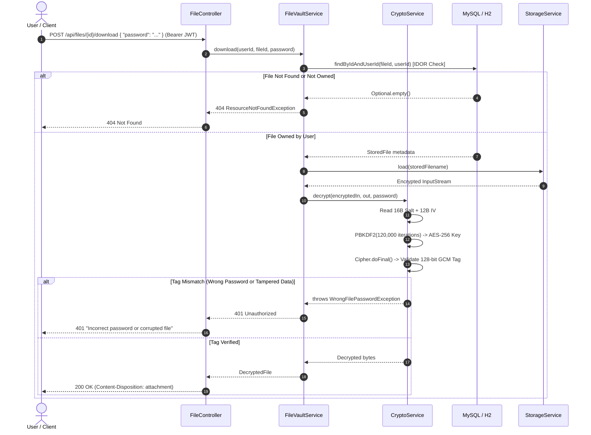

# 🔒 Secure File Locker — Spring Boot 3.5 & Java 21

[](https://openjdk.org/)
[](https://spring.io/projects/spring-boot)
[](https://spring.io/projects/spring-security)
[](https://csrc.nist.gov/publications/detail/sp/800-38d/final)
[](https://www.docker.com/)
[](LICENSE)

An enterprise-grade, **Zero-Knowledge Encrypted File Vault REST API** built with **Java 21**, **Spring Boot 3.5**, and **Spring Security**. 

Rebuilt and hardened from a legacy Swing/JDBC desktop application, this service enforces zero-trust cryptographic guarantees: **the server never stores file passwords or password hashes**. Password correctness and file integrity are validated strictly by the **128-bit AES-GCM authentication tag**.

---

## 🏗️ Architecture & Cryptographic Flow

### 1. Zero-Knowledge Encryption on Upload
When a file is uploaded, a unique 16-byte random salt and 12-byte IV are generated using `SecureRandom`. The file password is fed into `PBKDF2WithHmacSHA256` (120,000 iterations) to derive an AES-256 key. The payload is encrypted with `AES/GCM/NoPadding`, outputting a unified blob:

```
+-------------------+------------------+--------------------------------------+
| Salt (16 bytes)   | IV (12 bytes)    | AES-256-GCM Ciphertext + 128-bit Tag |
+-------------------+------------------+--------------------------------------+
```

### 2. Zero-Knowledge Verification on Download (Sequence Diagram)



---

## 🛡️ Security Highlights: Desktop Legacy vs. Enterprise Service

| Vulnerability in Legacy Desktop App | Enterprise Fix in Spring Boot Service |
|---|---|
| **Weak Cipher:** Used `AES/ECB` with a hardcoded static string key | **AES-256-GCM** with per-file cryptographically secure random 16-byte salt and 12-byte IV. |
| **Plaintext Credential Storage:** File passwords stored in plaintext in DB (`SELECT ... WHERE file_password = ?`) | **Zero-Knowledge Architecture:** No file password or hash is ever persisted. The 128-bit GCM authentication tag itself verifies the key. |
| **Weak User Hashes:** Passwords hashed with unsalted SHA-256 | **BCrypt with Work Factor 12** via Spring Security. |
| **IDOR (Insecure Direct Object References):** Any user could access or delete any file ID | **Strict User-Scoped Queries:** All queries bind `findByIdAndUserId(fileId, userId)`. Cross-user access returns 404. |
| **PBKDF2 CPU Starvation / DoS:** Unthrottled key derivation requests | **In-Memory Token Bucket Rate Limiter:** Throttles decryption and authentication requests per IP/user (returns HTTP 429). |
| **Filename Injection / Path Traversal:** Raw filenames reflected in headers | **Sanitization Utility:** `FileUtils.sanitizeFilename()` removes CRLF, null bytes, and path separators. |

---

## 🚀 Quick Start

### Prerequisites
- **Java 21+**
- **Maven 3.9+** (or use packaged `./mvnw`)
- *(Optional)* Docker & Docker Compose

### 1. Run Locally (Zero Configuration)
The service automatically falls back to an embedded file-backed H2 database and default JWT secret:
```bash
mvn spring-boot:run
```
The API is live at `http://localhost:8083`.

### 2. Interactive Swagger UI & OpenAPI 3
Visit Swagger UI in your browser to inspect and execute requests:
👉 **[http://localhost:8083/swagger-ui/index.html](http://localhost:8083/swagger-ui/index.html)**

Click **Authorize** and input your JWT Bearer token: `Bearer <token>`.

### 3. Run with Docker Compose (Full Stack with MySQL 8)
```bash
docker-compose up -d --build
```
This provisions:
- `securefilelocker-mysql`: MySQL 8.0 container with health check.
- `securefilelocker-api`: Spring Boot 3.5 multi-stage container running as an unprivileged user.

---

## 📖 Complete cURL Walkthrough

### Step 1: Register User
```bash
curl -i -X POST http://localhost:8083/api/auth/register \
  -H "Content-Type: application/json" \
  -d '{"username": "sajar", "password": "SecurePassword123!"}'
```

### Step 2: Login & Obtain JWT
```bash
TOKEN=$(curl -s -X POST http://localhost:8083/api/auth/login \
  -H "Content-Type: application/json" \
  -d '{"username": "sajar", "password": "SecurePassword123!"}' | grep -o '"token":"[^"]*' | grep -o '[^"]*$')

echo "JWT Token: $TOKEN"
```

### Step 3: Upload & Encrypt File
```bash
echo "Top secret financial data" > confidential.txt

curl -i -X POST http://localhost:8083/api/files \
  -H "Authorization: Bearer $TOKEN" \
  -F "file=@confidential.txt" \
  -F "password=LockerPassword999!"
```

### Step 4: List Uploaded Files
```bash
curl -i -X GET http://localhost:8083/api/files \
  -H "Authorization: Bearer $TOKEN"
```

### Step 5: Download & Decrypt File (Correct Password)
```bash
curl -i -X POST http://localhost:8083/api/files/1/download \
  -H "Authorization: Bearer $TOKEN" \
  -H "Content-Type: application/json" \
  -d '{"password": "LockerPassword999!"}' \
  --output decrypted_output.txt

cat decrypted_output.txt
```

### Step 6: Attempt Download with Wrong Password (Returns 401)
```bash
curl -i -X POST http://localhost:8083/api/files/1/download \
  -H "Authorization: Bearer $TOKEN" \
  -H "Content-Type: application/json" \
  -d '{"password": "WrongPassword!"}'
```
*Response:* `HTTP/1.1 401 Unauthorized` — `{"status":401,"error":"Unauthorized","message":"Incorrect password or corrupted file"}`

---

## 🧪 Comprehensive Test Suite

The project includes unit tests, Mockito component tests, and full MockMvc integration tests:

| Test Class | Test Target | Key Assertions |
|---|---|---|
| `CryptoServiceTest` | AES-256-GCM & PBKDF2 | Round-trip encryption/decryption, bad tag detection, IND-CPA uniqueness, tamper detection, truncated file handling |
| `UserServiceTest` | User registration & authentication | Password encoding, JWT token generation, duplicate user prevention, credential validation |
| `FileVaultServiceTest` | File lifecycle & StorageService | Mocked storage interaction, empty file validation, IDOR ownership filtering, file deletion |
| `AuthControllerIntegrationTest` | End-to-end `/api/auth` HTTP endpoints | 200 on valid register/login, 409 on duplicate username, 401 on bad credentials, 400 on validation errors |
| `FileControllerIntegrationTest` | End-to-end `/api/files` HTTP flow | Upload, list, download, wrong-password 401, **IDOR isolation (User B cannot access or delete User A's files)** |

Run all tests:
```bash
mvn clean test
```

---

## 💼 Interview & Resume Preparation Guide

For in-depth technical defense, STAR-format interview narratives, and 15 staff-level technical Q&As (covering cryptography, streaming trade-offs, and scalability), check out:
👉 **[INTERVIEW_PREP.md](INTERVIEW_PREP.md)**

---

## 📄 License
This project is licensed under the MIT License — see the [LICENSE](LICENSE) file for details.
